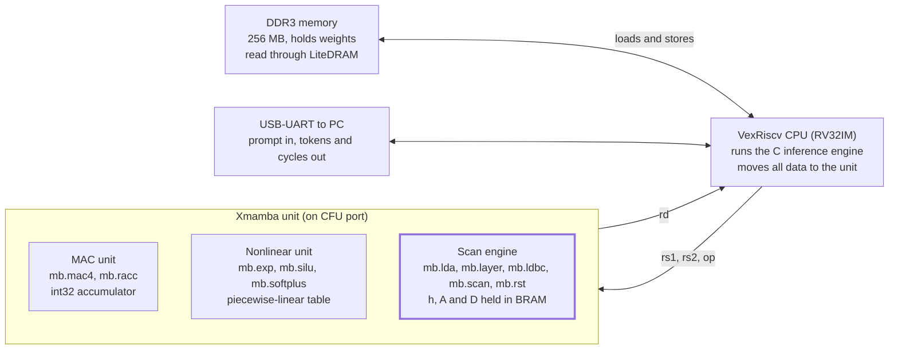
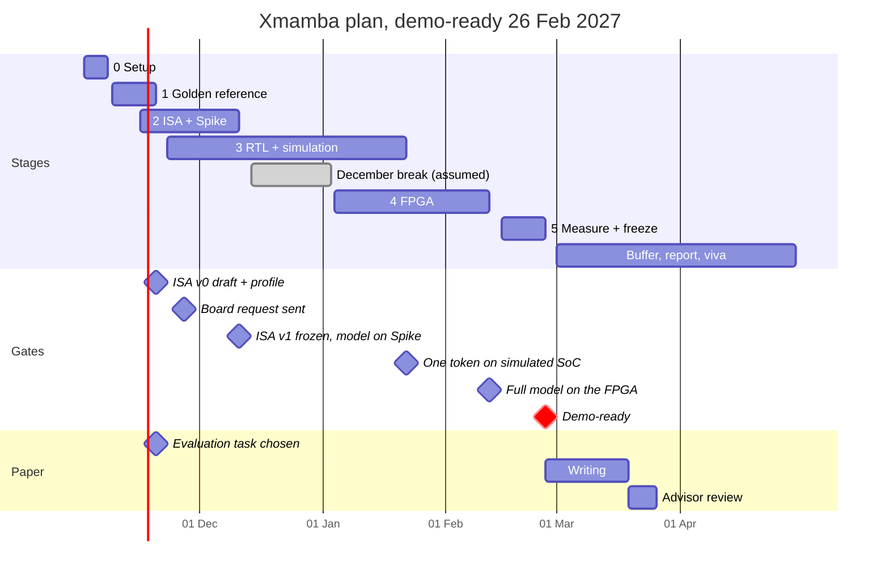

# Xmamba: RISC-V Extension for Mamba — Project Plan

## Overview

We will build **Xmamba**, a custom RISC-V instruction-set extension that speeds up inference of our trained Mamba model, prove it in the Spike simulator, implement it in Verilog inside an open-source RISC-V core, and demo the full model running on a Xilinx FPGA. The whole system must be demo-ready by Feb 26, 2027; March is buffer and polish, April is final submission.

The final demo shows:

- Our trained model (under 5M parameters) running end to end on a RISC-V soft core on the FPGA, matching the Python reference within an agreed error bound.
- Two builds on the same board, side by side: plain RV32IM software versus RV32IM + Xmamba.
- Measured results: cycles per token, tokens per second, speed-up, FPGA resources (LUTs, flip-flops, DSPs, BRAM), maximum clock, and accuracy loss from fixed-point arithmetic.
- Supporting work: an Xmamba ISA spec, a Spike model of the extension, RTL with tests, and the report.

The plan has six stages: setup, golden reference, ISA design on Spike, RTL in simulation, FPGA, and evaluation. Hardware and software tracks overlap so nothing waits on a single person, and every stage has a fallback (see Risks).

## Team and roles

Members are labelled A to E. Each owns one workstream from start to finish and works closely with one other member; every task list below is headed by the member who owns it.

|Member|Role|Owns|Works most with|
|---|---|---|---|
|A|Hardware (RTL & FPGA)|Xmamba unit in Verilog, SoC integration, FPGA builds, timing closure|B|
|B|ISA & Software|Xmamba ISA spec, Spike model, C inference engine, optimized kernels, performance analysis|A|
|C|Model & Reference|Trained weights and export, Python reference model, lookup tables, accuracy checks, test vectors|B|
|D|Testing & Benchmarks|Directed tests, regression scripts, bug log, benchmark runs, results sheet and charts|A|
|E|Documentation & Coordination|Literature survey, weekly notes and tracker, report, slides, figures, poster, demo video|Everyone|

The ISA spec is the contract between A and B; after the freeze, neither changes it without the other. C supplies the ground truth that every implementation is checked against. D turns that ground truth into one-command checks, and E keeps the record that becomes the report.

## How Mamba computes, and where the time goes

Mamba spends its time on two very different kinds of work: weight-heavy matrix-vector products, and an exp-heavy elementwise recurrence. Each needs its own kind of instruction, which is the core idea behind Xmamba.

A Mamba model is a stack of identical blocks with residual connections. During generation it runs as a recurrence: each new token updates a fixed-size hidden state. Cost per token is constant and there is no growing key-value cache as in a Transformer, which suits a small core with limited memory.

One block, for one token. Notation: d = model width, E = expansion factor (usually 2), N = state size (usually 16), R = rank of the Δ projection.

1. RMSNorm the input vector (length d).
2. **in_proj**: a matrix-vector product producing u and a gate z, each of length E·d.
3. **conv1d**: a causal depthwise convolution over the last 4 values of each channel of u, then SiLU.
4. **x_proj** and **dt_proj**: produce Δ (one step size per channel, through softplus), and the vectors B and C (length N each) from u.
5. **Selective scan**: update the E·d × N hidden state h and produce output y (below).
6. Multiply y by SiLU(z), apply **out_proj** back to width d, and add the residual.

The selective scan, for every channel i and state index n:

```latex
\bar{A}_{i,n} = \exp(\Delta_i A_{i,n}), \qquad h_{i,n} \leftarrow \bar{A}_{i,n}\, h_{i,n} + \Delta_i B_n u_i, \qquad y_i = \sum_{n=1}^{N} C_n h_{i,n} + D_i u_i
```

"Selective" means Δ, B and C are computed from the current input, so the recurrence changes every token. A and D are learned constants, and A is negative, so exp(Δ·A) always lies between 0 and 1. B and C are shared by all channels within a token, which the hardware design exploits.

|Part of the block|Work per token|Behaviour on a small RV32IM core|
|---|---|---|
|Linear layers (in_proj, x_proj, dt_proj, out_proj)|About 3E·d² + E·d·(R + 2N) + R·E·d multiply-accumulates|Most of the arithmetic. Every weight is read once per token, so once the multiplies are fast, memory bandwidth becomes the limit.|
|Selective scan|E·d·N exponentials plus about 3E·d·N multiplies|Elementwise, no weight reuse. Each exponential is a long software routine on a core without an FPU.|
|Activations (SiLU, softplus) and RMSNorm|About 3E·d function evaluations|Each needs an exponential, divide or square root in software.|
|conv1d|4E·d multiply-accumulates|Small.|

The real split for our model is measured in Stage 1, not assumed. Amdahl's law applies: if a kernel takes a fraction f of the time, speeding it up alone can never give more than 1/(1 − f) overall.

## Key design decisions

We will add tightly coupled custom instructions to a VexRiscv RISC-V core using the CFU Playground framework on an Arty A7-100T board, with fixed-point arithmetic throughout.



The scan engine (highlighted) is the Mamba-specific part; the MAC and nonlinear units would help any small neural network.

### 1. Custom instructions inside the pipeline, not a separate accelerator

There are two ways to add hardware to a RISC-V system. A loosely coupled accelerator sits on the bus with its own memory access, like Gemmini on the Rocket core. A tightly coupled unit sits inside the pipeline and executes R-type custom instructions: two source registers in, one result out.

We choose the tightly coupled unit. It is a true ISA extension, it needs no bus or DMA design, and C code uses it like any other instruction. The cost is that only 64 bits enter per instruction and the unit cannot touch memory; the CPU moves all data ([CFU Playground overview](https://cfu-playground.readthedocs.io/en/latest/overview.html)). We work around this by keeping the scan state h, and the constants A and D, inside the unit, so they never cross the register interface.

### 2. Platform: CFU Playground on an Arty A7-100T

[CFU Playground](https://cfu-playground.readthedocs.io/) builds a LiteX system-on-chip around a VexRiscv soft CPU that has a Custom Function Unit (CFU) port, plus 256 MB of DDR and a USB-UART. CFUs can be written in plain Verilog, bitstreams are built with Vivado, and Renode can simulate the whole SoC together with a Verilator model of the CFU. That means the full system runs in simulation before any board arrives.

**Board to request: [Arty A7-100T](https://digilent.com/shop/arty-a7-artix-7-fpga-development-board/).** It has an XC7A100T FPGA with 101,440 logic cells, 240 DSP slices, 4,860 Kbit of block RAM and 256 MB of DDR3L. The free Vivado edition supports it. The smaller Arty A7-35T is retired. CFU Playground has been tested on both Arty A7 variants and on the Nexys Video, which is the fallback board.

We are not using Rocket/Chipyard or CVA6. They are larger cores with longer build times and a steeper learning curve, which a model under 5M parameters does not need.

### 3. Fixed-point arithmetic

The core is integer-only (RV32IM): floating point in software is slow, and a hardware FPU costs FPGA area. Integer multipliers map directly onto the FPGA's DSP slices. Proposed formats, to be validated in Stage 1:

- **Linear layers**: int8 weights and activations, one scale per tensor for weights and per channel for activations, int32 accumulators.
- **Scan**: Δ, B, C, u and h in 16-bit or 32-bit fixed point. Rounding errors in h carry into every later token, and Mamba is known to be harder to quantize than Transformers because of scattered activation outliers ([LightMamba](https://arxiv.org/abs/2502.15260)).
- **exp, SiLU, softplus**: piecewise-linear segments from a small coefficient table (see What we take from Mamba-X). Since exp(Δ·A) only takes inputs ≤ 0, its output lies in (0, 1] and the table stays small.

The software baseline uses the same formats and the same tables. Baseline and Xmamba outputs are then bit-identical, and the speed-up compares like with like.

### 4. Xmamba v0 instruction set (proposal, frozen in Stage 2)

All instructions use the custom-0 major opcode (0001011) in R-type format: funct3 picks the group and funct7 picks the operation. C code emits them with the assembler's `.insn r CUSTOM_0, funct3, funct7, rd, rs1, rs2` directive in inline assembly, so the compiler needs no changes. Non-standard RISC-V extensions are named with an X prefix, hence Xmamba.

|Instruction|Operands|Effect|Used for|
|---|---|---|---|
|mb.mac4|rs1, rs2|acc += dot product of the four int8 lanes of rs1 and rs2|All linear layers, conv1d|
|mb.racc|rd, rs1|rd = acc rescaled by shift rs1 and saturated; acc cleared|End of each output element|
|mb.exp, mb.silu, mb.softplus|rd, rs1|rd = f(rs1) in fixed point, by table lookup and interpolation|Activations and Δ|
|mb.lda|rs1, rs2|Write an A or D value (rs2) into unit memory at address rs1|Once at start-up|
|mb.layer|rs1|Select which layer's state and constants the scan uses|Start of each layer|
|mb.ldbc|rs1, rs2|Write B_n and C_n (a packed 16-bit pair in rs2) for n = rs1|N times per token per layer|
|mb.scan|rd, rs1, rs2|For channel rs2, with packed (Δ_i, u_i) in rs1: update all N states h_i,n in unit memory and return y_i|E·d times per token per layer|
|mb.rst|none|Clear all scan state|Start of each sequence|

Per token and layer, the scan drops from E·d·N software exponentials and their arithmetic to N + E·d custom instructions. RMSNorm stays in software unless profiling says otherwise. The state memory needs layers × E·d × N × 4 bytes, which must fit comfortably in the board's 607.5 KB of block RAM.

## Stage 0 — Setup and onboarding (2–8 Nov)

By 8 Nov, everyone can compile C for RISC-V and run it on Spike, the CFU Playground template runs in simulation, and the model's exact dimensions are written down.

**What this stage is about.** Three tool stacks do all the work. The RISC-V GNU toolchain cross-compiles bare-metal C (no operating system) for RV32IM. Spike, the official functional simulator, executes the compiled program instruction by instruction, with no notion of clock cycles.

CFU Playground bundles the hardware flow: LiteX builds the SoC, VexRiscv is the CPU, Vivado produces the bitstream, and Renode with Verilator simulates the system. Everyone uses the same Linux setup (Ubuntu LTS, native or in a VM), so a script that works for one person works for all.

**A · Hardware**

- [ ] Install Vivado (free edition) and CFU Playground; run its setup script.
- [ ] Build the template project and run it in Renode or Verilator simulation.
- [ ] Read the CPU–CFU interface page and write a half-page summary of the handshake signals for the team.

**B · ISA & Software**

- [ ] Build the RISC-V GNU toolchain for rv32im with newlib; build Spike and the proxy kernel.
- [ ] Run hello-world on Spike, then a bare-metal program that reads the cycle and instret counters.
- [ ] Create the Git repository with the layout in "How we work".

**C · Model & Reference**

- [ ] Locate the trained checkpoint and training config. Fill in a model card: d_model, n_layers, d_state, d_conv, expand, dt_rank, vocabulary or input size, parameter count, task and accuracy metric.
- [ ] Export every weight tensor to its own .npy file, with a list of names and shapes.
- [ ] Load the weights into mamba-minimal (or our own training code) and confirm the outputs match the original model.

**D · Testing & Benchmarks**

- [ ] Reproduce the toolchain setup on your own machine from the ISA & Software owner's written steps, and fix any step that was unclear.
- [ ] Set up the task board (GitHub Projects or similar) with every task in this plan.

**E · Documentation & Coordination**

- [ ] Write a one-page summary each of the Mamba paper (sections 1–3), MARCA, LightMamba and the CFU Playground paper.
- [ ] Set up the report template (Overleaf/LaTeX) with chapter headings and a shared bibliography.
- [ ] Start the weekly notes page and record the decisions in this plan.

**Done when:** Spike runs our test program on every laptop, the CFU Playground template runs in simulation, and the model card is complete.

## Stage 1 — Golden reference, quantization and profiling (9–20 Nov)

By 20 Nov, a fixed-point C version of our model runs on Spike, matches the Python reference, and comes with a profile of where its instructions go. That profile decides the ISA.

**What this stage is about.** A golden model is a trusted reference that every later implementation is compared against. We build three levels, each checked against the one before: the PyTorch model we already have, a NumPy version of the single-token step written as plain loops, and a fixed-point C version on RISC-V. The C version is the baseline we accelerate.

Training code usually runs the scan in parallel over a whole sequence. On our core we generate one token at a time, so the references must use the recurrent step form: one state update per token.

**Quantization in brief.** Symmetric int8 quantization stores q = round(x / s), with a scale s per tensor. A dot product of int8 values accumulates exactly in int32, and one multiply-and-shift at the end converts back. Fixed-point Qm.n is a signed integer read as having n fractional bits: Q4.12 in 16 bits covers about −8 to +8 in steps of 1/4096.

**Profiling in brief.** Read the instret (instructions retired) counter before and after each kernel. Spike counts instructions exactly; on the FPGA the same code also reads mcycle, so the measurement code is written once and reused.

Also estimate the weight bytes read per token against the multiply-accumulates. An int8 matrix-vector product does about one MAC per weight byte fetched, so once MACs are cheap, DDR bandwidth caps the linear layers. The scan state stays on-chip, so its limit is compute.

**B · ISA & Software**

- [ ] Write the C inference engine: bare-metal, no malloc, weights linked in as a binary blob generated from the .npy files.
- [ ] Make the fixed-point version with the formats from Decision 3, including software lookup tables for exp, SiLU and softplus.
- [ ] Instrument each kernel with instret counters; produce the profile table (instructions per token, per kernel, % of total).
- [ ] Give Model & Reference a skeleton for the NumPy step function: signatures plus one worked layer.
- [ ] Draft ISA v0 from the profile and send it to Hardware for review (20 Nov).

**A · Hardware**

- [ ] Build a "hello CFU": a one-instruction unit (for example, add two registers) called from C in whole-SoC simulation.
- [ ] Synthesize the stock SoC for the XC7A100T in Vivado (no board needed); record LUTs, DSPs, BRAM and the achieved clock.
- [ ] Budget the Xmamba unit's DSP slices and BRAM for state memory, using the model card.
- [ ] Send the board request (Arty A7-100T, Nexys Video as fallback) by 27 Nov.

**C · Model & Reference**

- [ ] Complete the NumPy step function from the skeleton; check it against PyTorch on 20 sequences (maximum absolute error under 1e-4).
- [ ] Export test vectors: inputs and outputs of every stage of every layer for 10 tokens, as binary files with a README describing the layout.
- [ ] Write an accuracy script that scores any implementation's outputs on 100 test samples with the model's own metric.

**D · Testing & Benchmarks**

- [ ] Write compare.py: reads two output dumps, reports maximum and mean error, and prints PASS or FAIL against a tolerance.
- [ ] Create the results sheet (columns: date, build, test, metric, value, commit).
- [ ] Run the C engine on Spike against the test vectors and log the results.

**E · Documentation & Coordination**

- [ ] Draft the background chapter (Mamba and RISC-V custom extensions) from the literature summaries.
- [ ] Draw the Mamba block dataflow figure for the report.

**Done when:** the fixed-point C engine matches the NumPy reference within the agreed tolerance, the accuracy drop from float is within a threshold the team sets (for example, 1 percentage point), and the profile table and ISA v0 draft exist. If accuracy falls short, widen the scan state to 32 bits or move to per-channel scales before going further.

## Stage 2 — ISA spec and Spike simulation (23 Nov – 11 Dec)

By 11 Dec, the full model runs on Spike using Xmamba, its output is bit-identical to the C baseline, and ISA v1 is frozen.

**Encoding.** An R-type instruction is funct7 (7 bits) | rs2 (5) | rs1 (5) | funct3 (3) | rd (5) | opcode (7). The RISC-V spec reserves the custom-0 and custom-1 opcodes for extensions like ours, so we never collide with standard instructions. funct3 and funct7 together give 1,024 operation codes under one opcode.

**What the spec must pin down.** For each instruction: its encoding, how operands are packed (which bits of rs1 hold Δ and which hold u), exact rounding and saturation, a latency target, and the internal state it reads or writes. "Exact" matters, because Spike and the RTL must produce the same bits.

**One source of truth.** Write each instruction's behaviour once, as a C function in xmamba_ref.c. Spike calls these functions, and the same functions generate the expected results the RTL is tested against.

**Spike.** The documented way to add an instruction to [Spike](https://github.com/riscv-software-src/riscv-isa-sim) is to describe its behaviour and opcode in the simulator source and rebuild. Our instructions also keep internal state (the accumulator, h, B and C), so we model the whole unit as a Spike extension object that holds that state. Spike is functional, so it gives instruction counts, not cycles; cycles come from Stages 3 and 4.

**Fair comparison.** Report speed-up against the optimized fixed-point software baseline from Stage 1, not a naive float version. Examiners will ask.

**B · ISA & Software**

- [ ] Write ISA spec v1: encodings, packing, rounding, saturation, internal state and latency targets.
- [ ] Implement xmamba_ref.c and the Spike extension, including disassembly names so traces are readable.
- [ ] Write xmamba.h intrinsics (inline functions around .insn) and port all kernels to use them.
- [ ] Check outputs against the C baseline (bit-identical) and the NumPy reference.
- [ ] Report instruction counts per kernel and end to end: baseline, each instruction group alone, and full Xmamba.
- [ ] Freeze ISA v1 together with Hardware on 11 Dec.

**A · Hardware**

- [ ] Review each instruction for implementability: latency, DSP and BRAM cost, likely critical path.
- [ ] Write the unit's microarchitecture note: block diagram, mb.scan state machine, BRAM layout, pipeline stages.
- [ ] Start the RTL for mb.mac4 and mb.racc (Stage 3 starts early for Hardware).

**C · Model & Reference**

- [ ] Write gen_luts.py: generates the exp, SiLU and softplus tables from the spec and reports their maximum error against NumPy.
- [ ] Run the accuracy script on the Spike Xmamba outputs and record accuracy against float.
- [ ] Freeze the model weights by 11 Dec; no retraining after this without team agreement.

**D · Testing & Benchmarks**

- [ ] For each instruction, write directed tests from the spec: typical values, zero, maximum, minimum and saturation cases, with expected results from xmamba_ref.c.
- [ ] Write run_all.sh: builds everything and runs every Spike test, printing one PASS/FAIL line each.

**E · Documentation & Coordination**

- [ ] Typeset the ISA spec as a report chapter, with encoding tables and operand diagrams.
- [ ] Prepare slides for the first project review: problem, approach, ISA, Spike results.

**Done when:** run_all.sh passes on Spike, the instruction-count table is in the results sheet, and ISA v1 is tagged in the repository.

**December break (14 Dec – 3 Jan, assumed).** No planned work. The board should arrive during the break; the nonlinear-unit RTL may continue if Hardware wants to get ahead.

## Stage 3 — RTL design and Verilator simulation (from 23 Nov; main push 4–22 Jan)

By 22 Jan, every Xmamba instruction passes its tests in RTL simulation, one full token runs on the simulated SoC with output identical to Spike, and synthesis meets timing.

**The CPU–unit handshake.** The CPU raises a command-valid signal carrying the function code (funct3, funct7) and both operand values; the unit accepts it with a ready signal. When the result is ready, the unit raises response-valid with a 32-bit value, and the CPU writes it to rd. An instruction may take several cycles while the CPU stalls; operands are valid for one cycle only, so the unit must latch them, and a unit that never answers hangs the CPU ([interface details](https://cfu-playground.readthedocs.io/en/latest/interface.html)).

Xmamba uses two patterns described on that page. mb.mac4 and mb.racc follow the accumulation pattern: stream data in, read the result once. mb.lda and mb.ldbc follow the addressable-register pattern: write values into indexed storage inside the unit.

**Inside the unit.**

- **MAC unit**: four 8×8 multipliers feed an adder tree and an int32 accumulator register. The FPGA's DSP slices can absorb the multipliers.
- **Nonlinear unit**: a ROM table in block RAM, indexed by the top bits of the input; the low bits drive a linear interpolation with one multiply.
- **Scan engine**: a small state machine that steps n from 0 to N−1. Each step reads A and h from BRAM, computes exp(Δ·A) through the table, updates h, writes it back and accumulates C·h. Pipelined, it handles one state per clock, so mb.scan costs about N cycles plus pipeline fill. Dual-port BRAM lets it read the next h while writing the current one.

**Verification in two layers.** Unit tests drive each instruction with vectors from xmamba_ref.c and compare every bit. System tests run the real C program on the simulated SoC — the same program that ran on Spike.

**Timing.** Run Vivado synthesis for the XC7A100T every week, even before the board arrives. The timing report shows the slowest path; negative slack means the clock target is too fast, and the usual fix is a pipeline register on that path.

**A · Hardware**

- [ ] mb.mac4 and mb.racc RTL with unit tests (by 11 Dec).
- [ ] Nonlinear unit RTL with unit tests (by 11 Dec; may run into the break).
- [ ] Scan engine RTL with unit tests (4–15 Jan).
- [ ] Integrate the unit into the CFU Playground SoC and simulate one full token (18–22 Jan).
- [ ] Weekly Vivado synthesis; record LUTs, flip-flops, DSPs, BRAM and worst slack.

**B · ISA & Software**

- [ ] Port the C engine to the CFU Playground SoC: start-up code, UART output, timers, weights placed in DDR.
- [ ] Build the measurement harness: cycles per kernel and per token, printed over UART.
- [ ] Write the demo application: input over UART, generate tokens, print cycles per token.
- [ ] Debug any Spike-versus-SoC mismatch together with Hardware.

**C · Model & Reference**

- [ ] Prepare 10 demo inputs (prompts or samples) and their expected outputs from the reference.
- [ ] Keep the test vectors and accuracy script in sync with any spec change.

**D · Testing & Benchmarks**

- [ ] Extend run_all.sh to run the RTL unit tests in Verilator and the whole-SoC test; log every failure in the bug log.
- [ ] Run the full regression twice a week and post the PASS/FAIL summary in the team channel.

**E · Documentation & Coordination**

- [ ] Write the methodology chapter: ISA design and Spike results.
- [ ] Redraw the microarchitecture figures from Hardware's sketches.

**Done when:** all unit tests pass, one token on the simulated SoC matches Spike bit for bit, and synthesis meets timing at the chosen clock target.

## Stage 4 — FPGA bring-up and full-model run (bring-up 4–8 Jan; main push 25 Jan – 12 Feb)

By 12 Feb, the full model runs on the Arty A7-100T in both builds, its output matches simulation, and the speed-up is measured on real hardware.

**From RTL to a running board.** Vivado turns the SoC into a bitstream in three steps: synthesis (Verilog to gates), implementation (placing and routing on the chip) and bitstream generation. The program is then loaded over the USB-UART and runs with its weights in DDR.

**Bring up in small steps.** Stock SoC and a UART hello first, then a DDR memory test, then the baseline engine, then Xmamba. Each step adds exactly one new thing that can break.

**Debugging on hardware.** If the board and simulation disagree, Vivado's Integrated Logic Analyzer (ILA) records chosen internal signals on the chip, like a logic analyzer built into the FPGA.

**Measuring.** Cycles come from the mcycle counter, and tokens per second is clock frequency ÷ cycles per token. Resources come from Vivado's utilization report, and power from its power report (an estimate, labelled as such).

**A · Hardware**

- [ ] As soon as the board arrives: stock CFU Playground bitstream, UART hello, DDR test (4–8 Jan).
- [ ] Build the Xmamba bitstream and close timing at the target clock.
- [ ] Debug any hardware-only failure with the ILA.
- [ ] Produce final utilization, timing and power reports for both builds.

**B · ISA & Software**

- [ ] Run the baseline and Xmamba builds on the board; confirm output matches simulation bit for bit.
- [ ] Tune the software: pack four int8 weights per word, unroll inner loops, keep hot data in cache.
- [ ] Collect cycles per kernel and per token on hardware.

**C · Model & Reference**

- [ ] Run the accuracy script on 100 samples from the board's UART log, for both builds.

**D · Testing & Benchmarks**

- [ ] Shadow the board bring-up and write the step-by-step "how to run the demo" guide.
- [ ] Run the benchmark matrix on the board: baseline, each instruction group alone, full Xmamba, three runs each; fill the results sheet and make the charts.

**E · Documentation & Coordination**

- [ ] Photograph the setup and record a short demo video.
- [ ] Draft the implementation and results chapters.

**Done when:** both builds run the full model on the board, outputs match simulation, and the benchmark matrix is complete.

## Stage 5 — Evaluation, freeze, buffer and submission (15 Feb – Apr)

The demo is frozen on 26 Feb. March is reserved for fixing slips, stretch goals and the report; April is for final submission and the viva.

Treat 26 Feb as the real deadline. After it, work is either a fix, a stretch goal or writing. A tagged release (v1.0) means anyone can rebuild the exact demo from the repository.

|Result we report|How it is measured|
|---|---|
|Cycles per token|mcycle counter, averaged over 100 tokens|
|Tokens per second|Clock frequency ÷ cycles per token|
|Speed-up|Baseline cycles ÷ Xmamba cycles, per kernel and end to end|
|Instruction-count reduction|Spike, per kernel|
|FPGA resources|Vivado utilization: LUTs, flip-flops, DSPs, BRAM, for both builds|
|Maximum clock|Vivado timing report|
|Power (estimate)|Vivado power report|
|Accuracy|Accuracy script: float vs fixed-point on Spike vs board|

**A · Hardware**

- [ ] Final measurements and reports (15–26 Feb).
- [ ] Stretch: four parallel lanes in the scan engine; deeper pipelining for a higher clock.

**B · ISA & Software**

- [ ] Final measurements; tag v1.0 on 26 Feb.
- [ ] Stretch: an rsqrt instruction for RMSNorm; weight prefetching; a short paper for a student conference.

**C · Model & Reference**

- [ ] Final accuracy table across float, Spike and board.
- [ ] Stretch: time the same model on a laptop CPU and a Raspberry Pi for context.

**D · Testing & Benchmarks**

- [ ] Rebuild v1.0 from a clean clone and rerun the full regression to prove it is reproducible.
- [ ] Keep the results sheet and charts final and consistent with the report.

**E · Documentation & Coordination**

- [ ] Full report draft by 26 Mar; every member reviews their own chapter.
- [ ] Poster, final slides and a viva question bank by 9 Apr.

**Done when:** the final report is submitted on the college's date and the demo runs from v1.0 on demand.

## Paper track

We aim for one short paper (4–6 pages) submitted in March–May 2027, plus an arXiv preprint. The claim is deliberately narrow: a stateful selective-scan unit, added as a tightly coupled RISC-V ISA extension to a microcontroller-class core, measured on real FPGA hardware.

### Where Xmamba sits among related work

Mamba acceleration is a crowded field, but existing work is either a standalone accelerator or plain software. None of the work below adds the scan to a small core's instruction set.

|Work|What it is|Platform|How Xmamba differs|
|---|---|---|---|
|[MARCA](https://arxiv.org/abs/2409.11440) (ICCAD 2024)|Reconfigurable Mamba accelerator that reuses its PEs for nonlinear functions|Verilog, cycle-accurate simulator|Ours is an ISA extension measured on a real board|
|[LightMamba](https://arxiv.org/abs/2502.15260) (DATE 2025)|FPGA accelerator with 4-bit post-training quantization for Mamba-2|Versal VCK190, Alveo U280|Large FPGAs and LLM-scale models; we target a microcontroller-class core|
|[SpecMamba](https://arxiv.org/abs/2509.19873) (2025)|FPGA accelerator with speculative decoding|FPGA|Same contrast as LightMamba|
|[Mamba-X](https://arxiv.org/abs/2508.02977) (ICCAD 2025)|Vision Mamba accelerator: systolic scan array, lookup-table function unit, hybrid INT8 quantization|65 nm synthesis and cycle-level simulator, compared with a Jetson AGX Xavier|Standalone accelerator with its own DMA; we sit inside the CPU pipeline|
|[eMamba](https://arxiv.org/abs/2508.10370) (2025)|End-to-end Mamba acceleration framework for edge devices|FPGA and GF 22 nm|Standalone accelerator, not an ISA extension|
|[FEMBA on the Edge](https://arxiv.org/abs/2603.26716) (2026)|Quantized Mamba EEG model deployed in software on a RISC-V microcontroller|GAP9|Software only; the closest comparison in spirit|
|[VEXP](https://arxiv.org/abs/2504.11227) (2025)|RISC-V ISA extension for the exponential in softmax|12 nm compute cluster|Same method, but for Transformers, not SSMs|

### What we take from Mamba-X

- **Smaller nonlinear unit.** Mamba-X fits each function with piecewise-linear segments: 16 table entries for exp and 32 for SiLU and softplus, with breakpoints placed where profiled inputs actually fall (exp inputs lie between about −8.5 and 0). We adopt this instead of a large ROM.
- **Per-channel scales for scan activations.** In Mamba-X, one scale per tensor for the SSM activations cut ImageNet top-1 accuracy from 76.0% to 14.7%; per-channel scales kept 75.5%. Weights were fine with one scale per tensor.
- **Power-of-two scales.** Rounding scales to powers of two turns rescaling into a shift, which mb.racc already assumes.
- **Report kernel and end-to-end numbers.** Mamba-X's 11.6× scan speed-up became 2.3× end to end, because the matrix multiplies were not accelerated. Expect the same shape and present it the same way.
- **The task decides the scan design.** Mamba-X parallelizes the scan across a whole image, because the full sequence is known in advance. That works for classification (keyword spotting, ECG) but not for token-by-token generation. If we choose a classification task, a parallel chunked scan becomes a possible stretch goal.

### Building on our Scan-Fuse abstract (MICRO 2026 SRC)

Xmamba is the "full core integration and end-to-end evaluation" that the Scan-Fuse abstract (A and B) listed as next steps, so the paper should present it as that follow-up. Scan-Fuse proposed one fused vector instruction for the parallel-scan combine step, (a_j·a_i, a_j·b_i + b_j), replacing a vmul + vfmacc pair. Four lessons from it shape how we argue Xmamba.

- **Compare against the right baseline.** A single core does not need a parallel scan. Vectorised across channels instead of across time, the recurrence h = a·h + b is already one fused multiply-add per step (RVV's vfmadd.vv). A Blelloch scan does about 2L combines and Hillis–Steele about L·log₂L, against L sequential steps, so the honest CPU baseline is the sequential recurrence. Reviewers will check this.
- **Measure, don't count.** Halving issue count follows directly from replacing two instructions with one, so it is a model, not a measurement. Xmamba reports cycles on a running core.
- **Target where a CPU actually spends time.** On an integer core the cost sits in exp(Δ·A), building ΔB·u, the C·h reduction and the linear layers, not in the combine. That is what the Xmamba unit covers.
- **Keep what worked.** The standalone Verilog datapath, the Yosys/nextpnr flow and the area-versus-critical-path comparison carry over directly. Report area and critical path per instruction group the same way.

A useful follow-up experiment: if the evaluation task is classification (whole sequence known in advance), add an mb.combine instruction and measure sequential mb.scan against a chunked parallel scan on the same core. Either outcome is publishable, because it tells readers when a parallel scan pays off on a small core.

### Decision needed by 20 Nov: the evaluation task

A paper needs a recognised edge task with a public dataset, not a toy model. Candidates: keyword spotting (Google Speech Commands), ECG arrhythmia (MIT-BIH), or human activity recognition (UCI HAR). Retrain the tiny model on the chosen task before the 11 Dec weight freeze; the current model can stay as the live demo.

### Experiments the paper needs

|Build or measurement|Why reviewers want it|Owner|
|---|---|---|
|Optimized fixed-point RV32IM software|The main baseline|ISA & Software|
|+ MAC unit only (a generic int8 unit)|Separates Mamba-specific gains from generic ML gains|ISA & Software, Hardware|
|+ MAC + nonlinear unit|Ablation step|ISA & Software, Hardware|
|Full Xmamba|Headline result|ISA & Software, Hardware|
|Float software on a VexRiscv build with an FPU, if it fits|Answers "why not just add an FPU?"|Hardware|
|LUTs, DSPs, BRAM, maximum clock, power estimate per build|Speed-up per unit of hardware spent|Hardware, Testing & Benchmarks|
|Accuracy: float vs fixed-point vs board|Cost of quantization|Model & Reference|
|Same model timed on a Raspberry Pi and a laptop|Context for the numbers|Model & Reference|

### Target venues

Deadlines below are from past editions; confirm each 2027 call for papers before planning around it.

|Venue|Why it fits|Past deadline pattern|
|---|---|---|
|CARRV workshop (with ISCA), if held in 2027|RISC-V ISA extensions and accelerators are explicitly in scope|March to May|
|IEEE ISVLSI|FPGA-design and ML-hardware tracks; 6 pages|February to March, possibly before our 26 Feb freeze|
|ACM GLSVLSI|VLSI and ML hardware|Early March (2 Mar in 2026)|
|ASP-DAC 2028|Edge-AI and TinyML hardware topics; 6 pages, double-blind|July (11 Jul 2026 for the 2027 edition)|
|arXiv|Preprint for CVs and applications|Any time, subject to venue policy|

### Paper tasks

- [ ] Choose the evaluation task (everyone, by 20 Nov).
- [ ] Retrain the tiny model on that task before the 11 Dec freeze (C, with B reviewing).
- [ ] Add the MAC-only and FPU builds to the benchmark matrix (A, B).
- [ ] Set up the paper skeleton in the IEEE two-column template and fill the related-work section (E, by 15 Jan).
- [ ] Produce all paper figures from the results sheet (D, by 5 Mar).
- [ ] Write the design and evaluation sections (A, B, by 12 Mar).
- [ ] Stretch: mb.combine and the sequential-versus-parallel scan comparison (A, B, March).
- [ ] Full draft by 19 Mar (A and B write, E edits); advisor review by 26 Mar; submit to the first venue whose deadline fits.
- [ ] Post the arXiv preprint once the venue's policy allows (E).

## Timeline and milestones

The demo is ready on 26 Feb, with March and April kept for fixes, stretch goals and the report.



Hardware starts in Stage 1 and runs alongside the software track, so the late-January FPGA work never waits on one hand-off. If a gate slips by more than a week, the matching fallback under Risks applies.

## Risks and fallbacks

Every major risk has a fallback and a date by which we decide. If several slip at once, the demo still stands at one of three levels: full Xmamba on the board; MAC and nonlinear units on the board with scan gains shown on Spike; or full Xmamba in whole-SoC simulation with board resource figures from Vivado.

|Risk|Early warning|Fallback|Decide by|
|---|---|---|---|
|CFU Playground will not build with current tools|Stage 0 template fails|Pin an older Ubuntu LTS in a VM; else switch to CFU Proving Ground, a lighter Verilog-only framework for the Arty A7 (check its memory support for our model size)|Nov 13, 2026|
|Fixed-point accuracy too low|Stage 1 accuracy check|32-bit scan state, per-channel scales, 16-bit activations in sensitive layers|Nov 20, 2026|
|Model changes late|Requests to retrain after the freeze|Weights frozen; any retrain needs the whole team's agreement and regenerated test vectors|Dec 11, 2026|
|Board arrives late|No board by 4 Jan|Continue in simulation; Vivado synthesis gives resources and timing without a board; borrow a lab board LiteX supports|Jan 11, 2027|
|DDR problems on the board|DDR test fails at bring-up|Retrain a smaller configuration with the existing training script so the model fits in on-chip BRAM|Jan 15, 2027|
|Scan engine RTL slips|Unit tests not passing by 15 Jan|Demo the MAC and nonlinear units on the board; report full-Xmamba gains from Spike|Jan 22, 2027|
|Timing not met at the target clock|Negative slack in weekly synthesis|Add pipeline stages; else lower the clock and report cycles per token, which do not depend on the clock|Feb 5, 2027|
|Exams or illness take someone out|A missed weekly sync|Hardware and ISA & Software review each other's work weekly, so either can pick up the other's critical task; vectors, tables and charts are generated by scripts anyone can rerun|Ongoing|

## How we work

One repository, one weekly rhythm, and a strict meaning of "done" keep five people from stepping on each other.

```
xmamba/
  model/      weight export, NumPy reference, gen_luts.py, accuracy script
  spec/       xmamba-isa.md (the contract between hardware and software)
  sw/         C inference engine, xmamba.h intrinsics, kernels
  sim/spike/  Spike extension, xmamba_ref.c
  hw/         rtl/, tb/, soc/ (the CFU Playground project)
  test/       test vectors, directed tests, run_all.sh, compare.py
  results/    results.csv and charts
  docs/       report, slides, figures, meeting notes
```

**Weekly rhythm**

- Monday: 30-minute sync. Each person says what they finished, what is next and what blocks them; Documentation & Coordination takes notes and updates the task board.
- Thursday: integration check between Hardware and ISA & Software.
- Friday: Testing & Benchmarks runs the full regression and posts the summary.

**Rules**

1. A task is done only when it is merged to main, passes run_all.sh, and any number it produced is in the results sheet.
2. After 11 Dec, an ISA change needs both Hardware and ISA & Software to agree, and must update xmamba_ref.c, Spike, the RTL and the tests together.
3. Model weights are frozen after 11 Dec.
4. Every build and run is a script or make target; nothing exists only on one laptop.
5. Blocked for more than a day? Say so in the team channel the same day.

## Reading list and sources

Everyone reads the Mamba paper (sections 1–3) and the CFU Playground overview in the first week. The rest is by role.

|Reading|Why|Who|
|---|---|---|
|[Mamba: Linear-Time Sequence Modeling with Selective State Spaces](https://arxiv.org/abs/2312.00752) (Gu and Dao)|The model we accelerate|Everyone|
|[mamba-minimal](https://github.com/johnma2006/mamba-minimal)|One-file PyTorch Mamba; the base for our NumPy reference|Model & Reference, ISA & Software|
|[CFU Playground documentation](https://cfu-playground.readthedocs.io/) and its [overview](https://cfu-playground.readthedocs.io/en/latest/overview.html)|Our SoC, CPU and build flow|Everyone|
|[CPU–CFU interface details](https://cfu-playground.readthedocs.io/en/latest/interface.html)|Handshake timing and multi-cycle patterns|Hardware, ISA & Software|
|[CFU Playground paper (DATE 2023)](https://past.date-conference.com/proceedings-archive/2023/DATA/352.pdf)|Citable description of the framework|Documentation & Coordination|
|[Spike (riscv-isa-sim)](https://github.com/riscv-software-src/riscv-isa-sim)|The ISA simulator we extend|ISA & Software, Testing & Benchmarks|
|[MARCA (ICCAD 2024)](https://arxiv.org/abs/2409.11440)|Mamba accelerator; piecewise nonlinear functions on reused hardware|Hardware, Documentation & Coordination|
|[LightMamba (DATE 2025)](https://arxiv.org/abs/2502.15260)|FPGA Mamba accelerator; why Mamba is hard to quantize|Model & Reference, Hardware|
|[Mambalaya (2026)](https://arxiv.org/abs/2604.03829)|Recent operator-fusion work on Mamba accelerators|Documentation & Coordination|
|[CFU Proving Ground](https://github.com/archlab-sciencetokyo/CFU-Proving-Ground)|Lighter fallback framework for the Arty A7|Hardware|
|[Arty A7 product page](https://digilent.com/shop/arty-a7-artix-7-fpga-development-board/)|Board resources and variants|Hardware|

Sources as of Oct 28, 2026.